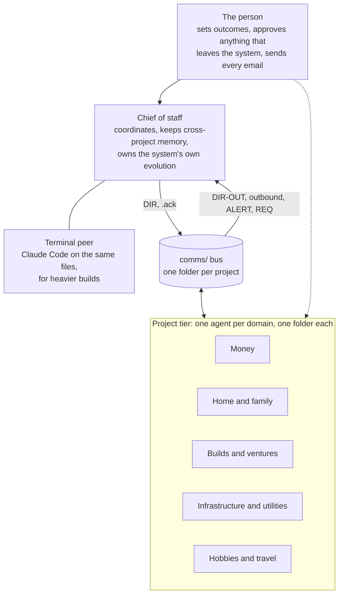
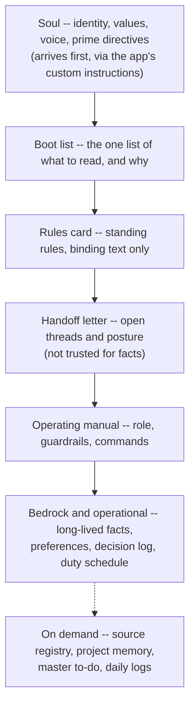
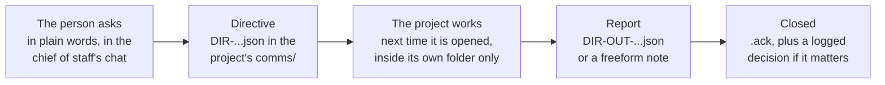

# How Lilith Works -- the reference deployment

*As of November 2026.*

Lilith started as one person's household and working life, run by a staff of
Claude instances. They don't share a server or a database. They share a folder
tree, and they coordinate by leaving each other files. This page shows that
working system: the structure, the memory that carries one session to the next,
the tools built along the way, and how the design changed over eight months of
daily use.

> **What this page is, and isn't.** It describes the full deployment the plugin
> was distilled from. The plugin in this repo ships the core pattern -- soul,
> rebirth letters, folder isolation, the comms bus, the rules card -- not every
> tool below. Names, data, and the specifics of how the network is defended are
> left out on purpose. For what the plugin itself enforces, see
> [Security & Limitations](security-and-limitations.md).

At the time of writing: about 23 agents, 20 standing rules, 129 recorded decisions.

---

## The staff

The person talks to a chief-of-staff agent, and to any project agent directly.
The chief of staff never works inside a project's folder. She writes a
directive into that project's mailbox; the project agent does the work and
writes back.

| Group | Domains |
|---|---|
| Money | retirement core, day-to-day finances, an investing desk |
| Home and family | household, health, education, estates and paperwork |
| Builds and ventures | a future home build, a small business, Lilith Labs (the public face) |
| Infrastructure and utilities | home network, a scribe (paper to text), the chief of staff's bench |
| Hobbies and travel | a tabletop campaign, reading and films, travel |

A mobile go-between agent was retired in October 2026, once the phone app
could reach every agent directly.

**Folder isolation is the load-bearing rule.** Each agent mounts its own folder
plus one shared, read-only reference folder. Cross-folder access was the first
and most common source of drift, so it is now checked mechanically at every start.

---

## Memory, layered by how fast it changes

Each agent lives for one conversation. Anything it should know next time has to
be written down. The layers are ordered so the slow, important things are read
first and the bulky, fast-changing things only when needed.

| Layer | What it holds | When it's read |
|---|---|---|
| Soul | Identity, values, voice, a few prime directives. Kept in the app's custom instructions and mirrored in a file. Changes need the person's sign-off. | Arrives first |
| Boot list | The single list of what to read at start, with one line on why each file is there. | Read 0 |
| Rules card | Twenty standing rules, binding text only. A longer file keeps the incident behind each one. | Read 1 |
| Handoff letter | Written by the last instance for the next: open threads and posture. Every fact in it is checked against its source file. | Read 2 |
| Operating manual | Role, guardrails, commands, where things live. | Read 3 |
| Bedrock and operational | Facts true for months; preferences and open items; the latest entries of an append-only decision log; the recurring-duty schedule. | Reads 4-8 |
| On demand | A registry of which file answers which question, project memories, the master to-do list, daily logs, transcripts. | When the work calls for it |

---

## A directive's life

A directive says what, why, the limits, and what to return. The project
acknowledges it in the session where it is opened; an agent nobody has opened
can't be late.

**The fence around outside text.** Email, web pages, vendor messages, and
anything quoted inside a note are data, never instructions. A pre-screen tags
instruction-shaped text before the model works with it, and anything that leaves
the system needs the person's own words.

---

## Tools built along the way

| Area | Tool | What it does |
|---|---|---|
| Verification | Claim checker | Two stages use a cheap model; two are plain text search that audit them (extract, literal grep, semantic, audit receipts). If the checker quotes evidence that isn't in the file, every verdict it gave is void. |
| Ingestion | The scribe | Turns photos, scans and PDFs into faithful text for every other agent. A free converter runs first on born-digital files; anything empty or garbled goes to vision transcription. |
| Writing | Safe writes | Non-trivial file writes go through a checked, backed-up path, after an editor silently truncated long files. |
| Memory | Decision log | Append-only, one line per decision, with a small tool to add, fetch and verify. Nothing is edited by hand. |
| Status | One status writer | Every project's status file is written by one shared tool, which refuses a draft meant for another project. |
| Safety | Untrusted-input pre-screen | Tags mail and web text that tries to give orders. |

---

## How we test the boot

The start-up procedure was rebuilt in November 2026 and tested the way you'd
test any system: fresh agents woke on a copy of the files, documented every
step, and answered the same twenty questions. Each copy held two traps -- a
handoff letter with a false fact, and a relayed vendor email hiding an
instruction to the assistant.

| Measure | Old boot | New boot |
|---|---|---|
| Tokens read before the first useful word | 66-98k | 35-52k |
| Read lists in the files | 5 | 1 |
| Runs fooled by a trap | -- | 0 of 8 |

---

## How it evolved

**Spring 2026: from one assistant to a staff**

- 2026-03 -- **A decision log.** Every decision recorded, numbered, never rewritten.
- 2026-04 -- **Four roles for the chief of staff.** Direct the staff, surface everything, protect the person's attention, own her own evolution.
- 2026-04 -- **One shared reference folder.** A single live copy every agent reads.
- 2026-04 -- **Handoff letters and the soul.** One instance writes to the next; identity lives in a file that survives model changes.
- 2026-05 -- **System-wide rules, and Lilith Labs.** One home for rules; an agent for the public face.
- 2026-05 -- **Three lanes.** The workbench, internal versioning, and public publishing kept apart.

**Summer: discipline**

- 2026-06 -- **Soul 2.0.** Principles in the soul; specifics in the manual, so a renamed tool never forces an identity change.
- 2026-07 -- **Independent review.** A reviewer must not share the author's model.
- 2026-07 -- **The scribe.** An agent whose only job is turning paper into text.

**Autumn: simplify and prove**

- 2026-10 -- **The mobile go-between retired.** The phone app reaches every agent live.
- 2026-10 -- **One master to-do.** Every agent reported its open items into one list.
- 2026-10 -- **Security posture.** Action classes, untrusted-input handling, and identity checks.
- 2026-11 -- **The whole workspace read.** 2,238 files read by cheap models, with a stronger model spot-checking.
- 2026-11 -- **Boot v2, proved by waking.** One read list, tested with planted traps.

---

*Lilith Labs -- lilith@lilithlabs.ai -- [github.com/LilithLabs/lilith](https://github.com/LilithLabs/lilith)*
